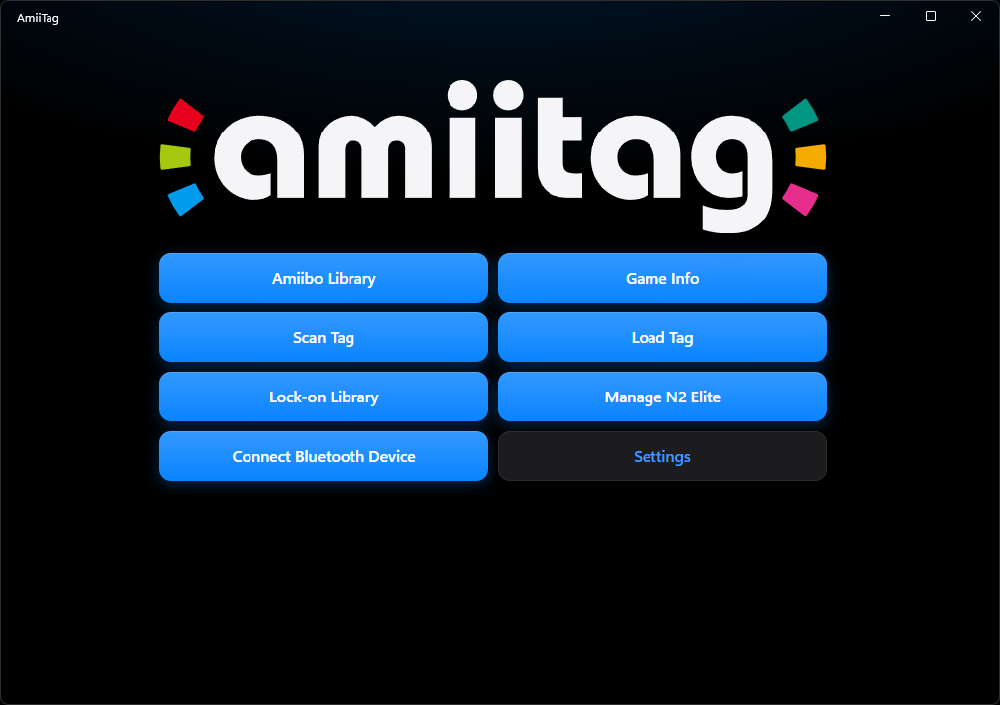

# AmiiTag

AmiiTag is a cross-platform app for reading, writing, organizing, and managing amiibo-compatible NFC tags and supported companion devices.

> [!IMPORTANT]
> **No amiibo data or encryption keys are included with AmiiTag.**
>
> You **MUST** provide your own legally obtained amiibo data and encryption keys. Encryption keys will not be provided with this project, by its maintainers, or through its support channels. Do not open an issue asking for keys or copyrighted amiibo data.

## Features

- Scan compatible NFC tags and view figure, tag, and usage information.
- Write supported tag data and app data to compatible NFC tags.
- Browse and search an organized amiibo library using data supplied by the user.
- View game compatibility and usage details.
- Save, load, and manage tag files.
- Manage v3 lock-ons and maintain a lock-on library.
- Connect to and manage supported Bluetooth devices, including Pixl.js, Puck.js, AmiiboLink, AmiLoop, along with the Flask / Slide from [bluuplabs](https://bluuplabs.com/).
- Connect to and manage N2 Elite banks.
- Use compatible USB NFC readers on supported desktop platforms.

See the [screenshot gallery](screenshots/README.md) for a tour of the main workflows.

## Platform support

| Platform | Support |
| --- | --- |
| [Web](https://dantheman827.github.io/AmiiTag/) | Supported for browsers that support WebBluetooth and WebSerial |
| Windows | Supported |
| Android | Supported |
| iPhone and iPad | Supported for users who can build and sign the app with an Apple Developer account |
| macOS | Supported for users who can build and sign the app with an Apple Developer account |

Apple builds require an active Apple Developer account and the appropriate signing configuration. AmiiTag is not distributed through this project as a pre-signed Apple application.

## NFC reader compatibility

AmiiTag supports compatible USB NFC readers, including PC/SC-compatible readers, on platforms that provide access to the required hardware interfaces. Reader capabilities vary, so support for a particular operation depends on both the reader and the tag being used.

Mobile devices can use supported built-in NFC hardware where the operating system permits the requested operation.

## Before using AmiiTag

You are responsible for providing:

1. Your own legally obtained amiibo data.
2. Your own legally obtained encryption keys.
3. Compatible NFC tags, an NFC-capable device, or a supported external reader.

AmiiTag does not download, bundle, distribute, or provide amiibo data or encryption keys. The maintainers cannot provide keys, point users to key downloads, or assist with obtaining copyrighted data.

Only use AmiiTag with data and hardware you are legally authorized to use. Keep backups of any important tag or device data before writing, replacing, or erasing it.

## Disclaimer

AmiiTag is an independent project and is not affiliated with, endorsed by, or sponsored by Nintendo. amiibo and Nintendo are trademarks of Nintendo.
